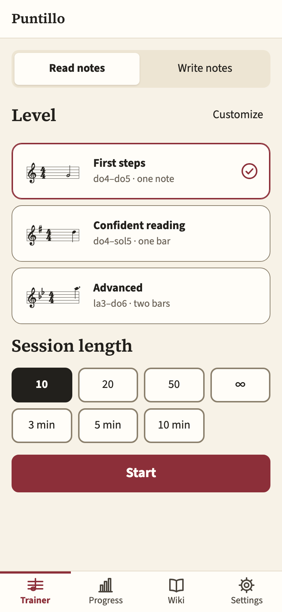
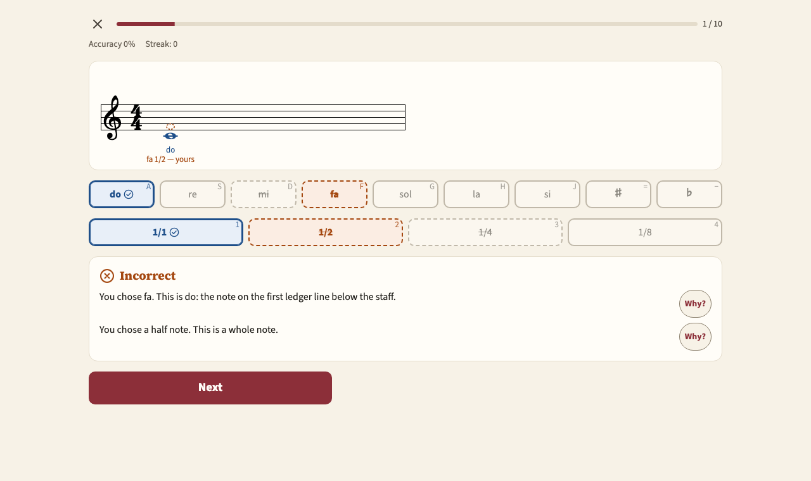

#  Puntillo

[](https://github.com/robinsout/puntillo/actions/workflows/ci.yml)
[](https://robinsout.github.io/puntillo/)
[](vitest.config.ts)
[](https://github.com/robinsout/puntillo/commits/master)
[](LICENSE)

[](https://robinsout.github.io/puntillo/lighthouse/)
[](https://robinsout.github.io/puntillo/lighthouse/)
[](https://robinsout.github.io/puntillo/lighthouse/)
[](https://robinsout.github.io/puntillo/lighthouse/)
[](https://robinsout.github.io/puntillo/lighthouse/)

A sight-reading trainer for the web: for beginners with no musical training and for musicians
who play by ear and want to learn to read music. Short sessions of 3–15 minutes, on a phone or a
computer.

**Open it: https://robinsout.github.io/puntillo/**

<p>
  
  
</p>

_Puntillo_ is Spanish for the augmentation dot, the little dot after a note that makes it half as
long again.

## Features

- **Read notes**: a note or a bar on the staff; answer with the note name or a piano key (on the
  screen, from the computer keyboard or from a MIDI instrument) and the duration.
- **Write notes**: put a named note on the staff, with its sign and duration.
- **Learning from mistakes**: a second try, the right answer and yours drawn on the staff, an
  explanation with a hint from the wiki, and the notes you missed coming back in the same session.
- **Levels and fine tuning**: three presets and manual settings for the range, ledger lines,
  durations, time signatures, rests, dots, key signatures and accidentals, with a live example.
- **Wiki**: articles on the treble staff, durations, accidentals, key signatures, keys and the
  piano keyboard, with music examples and a “Practice this” button.
- **Progress**: 30 days of history, the hardest notes, an unfinished session that survives a
  reload, export and import to a file. Everything stays in the browser.
- **Three interface languages** (English, Russian, Spanish) and note naming systems that switch
  independently of the language.

## How it is built

Vue 3, strict TypeScript, Pinia, Vue Router, Vue I18n, VexFlow for the notation, Web Audio for the
sound, Vitest and Playwright for the tests. Four layers with dependencies pointing inwards
(`presentation → application → domain ← infrastructure`); the domain is fully covered by tests.
The look is the “Music paper” design system built on tokens. Every feature starts from approved
acceptance criteria and is built in thin vertical slices, test first.

The specification, the acceptance criteria and the working rules are written in Russian:

- Specification: [`docs/spec.md`](docs/spec.md)
- Acceptance criteria of the features: [`docs/features/`](docs/features/)
- Design system: [`docs/design-system.md`](docs/design-system.md); a live catalogue is at
  `/design-system` on the dev server
- Working rules: [`CLAUDE.md`](CLAUDE.md)

## Requirements

Node.js of the version in `.nvmrc` (24.18.0). If your system has an older one:

```sh
nvm use
```

## Setup

```sh
npm install
```

## Commands

| Command                   | What it does                                                    |
| ------------------------- | --------------------------------------------------------------- |
| `npm run dev`             | Dev server at http://localhost:5173                             |
| `npm run build`           | Production build with type checking                             |
| `npm run preview`         | Serve the production build                                      |
| `npm run type-check`      | Type checking                                                   |
| `npm run lint`            | Linters (oxlint, ESLint, Stylelint) with fixes                  |
| `npm run lint:check`      | Linters without changing files                                  |
| `npm run format`          | Formatting                                                      |
| `npm run format:check`    | Formatting check                                                |
| `npm run test:unit`       | Unit and component tests in watch mode                          |
| `npm run test:unit:run`   | The same, once                                                  |
| `npm run test:coverage`   | Tests with coverage; the domain must be fully covered           |
| `npm run test:e2e`        | End-to-end tests with Playwright                                |
| `npm run render:examples` | Redraw the level examples of the start screen                   |
| `npm run render:icons`    | Redraw the favicon and the touch icon from `public/favicon.svg` |
| `npm test`                | Full check: types, linters, formatting, unit tests              |

## Layout

```
src/
  domain/          music rules, entities, note naming, grading. Plain TypeScript
  application/     use cases: session, question generation, checking, review queue, progress
  infrastructure/  storage, i18n, notation rendering, sound, MIDI, wiki
  presentation/    screens and stores; ui/ is the design system, shell/ the header and navigation
e2e/               end-to-end tests
scripts/           level examples, icons, Lighthouse badges
docs/              specification, acceptance criteria, design system
```

The direction of the dependencies is checked by the `no-restricted-imports` rule in
`eslint.config.ts`; style values that bypass the tokens are rejected by Stylelint.

## CI and deployment

On every pull request and push to `master` (`.github/workflows/ci.yml`): linters, formatting,
types, unit tests with coverage, the build, and end-to-end tests in Chromium, Firefox, WebKit,
Mobile Chrome and Mobile Safari. Once `master` is green, the build goes to GitHub Pages.

Before it is published, Lighthouse checks the build with the mobile profile: the scores become
the badges above and the full report is at https://robinsout.github.io/puntillo/lighthouse/. A
time to interactive over 3 s (spec §18) stops the deployment.

## License

[MIT](LICENSE). Piano sound: Salamander Grand Piano by Alexander Holm, CC BY 3.0.
